# CNIC OCR + Signature Verification: Architecture

## 1. Goal

A user uploads a **CNIC image** and a **specimen signature image**. The system:

1. Extracts text fields from the CNIC with a vision-language OCR model running in LM Studio.
2. Looks up the person's record through an external **DB API** (keyed by CNIC number).
3. Compares extracted fields with the DB record, with fuzzy matching where OCR noise is expected.
4. Crops the signature printed on the CNIC and compares it to the uploaded signature with a Siamese CNN.
5. Returns one verdict with a per-field breakdown.

## 2. Model decisions

| Concern | Choice | Why |
|---|---|---|
| OCR / field extraction | `allenai/olmocr-2-7b` (vision) via LM Studio | Qwen2.5-VL-based, built for document images |
| Model switching | Registry of **vision** models (`KYC_OCR_MODELS`), selectable per request | `qwen2.5-coder-7b-instruct` is text-only and cannot read images, so it is not in the registry. Any vision model loaded in LM Studio (e.g. a Qwen2.5-VL) can be added with one env var |
| LLM post-processing | Skipped (per decision) | The vision model returns JSON directly. A regex fallback covers malformed output |
| Signature verification | **SigNet** (Siamese-style CNN, writer-independent), PyTorch | Pretrained on GPDS, produces 2048-d embeddings, compared by cosine similarity. No per-person training needed |

## 3. Component diagram

```mermaid
flowchart LR
    subgraph Browser
        UI[Static HTML/JS UI<br/>upload CNIC + signature<br/>pick OCR model]
    end

    subgraph FastAPI["FastAPI app (app/main.py)"]
        API[/api/verify<br/>/api/ocr<br/>/api/models<br/>/api/health/]
        OCR[OcrService<br/>image prep, prompt,<br/>JSON parse, regex fallback]
        SIG[SignatureService<br/>ROI crop, SigNet embed,<br/>cosine score]
        CMP[Comparator<br/>normalise + fuzzy match]
        DBC[DbClient<br/>httpx, field mapping]
        MOCK[/mock-db/*<br/>dev-only mock API/]
    end

    LMS[(LM Studio<br/>OpenAI-compatible<br/>:1234/v1<br/>olmocr-2-7b)]
    DB[(External DB API<br/>GET /persons/&#123;cnic&#125;)]
    W[(weights/signet.pth)]

    UI -->|multipart| API
    API --> OCR -->|chat.completions + image| LMS
    API --> DBC --> DB
    DBC -.dev default.-> MOCK
    API --> CMP
    API --> SIG --> W
    API -->|JSON verdict| UI
```



## 4. Request flow (`POST /api/verify`)

```
1. Validate uploads (type, size) and chosen model against the registry
2. In parallel:
     a. OCR   : CNIC image -> LM Studio -> JSON fields (async HTTP)
     b. SIG   : crop signature ROI from CNIC -> SigNet embedding
                uploaded signature          -> SigNet embedding   (threadpool, CPU/GPU bound)
3. cnic_number = cnic_override or OCR cnic_number
4. DbClient.get_person(cnic_number)         -> DB record (or "not found")
5. Comparator.compare(extracted, db_record) -> per-field status + overall verdict
6. SignatureService score + threshold       -> genuine / uncertain / forged
7. Return { extracted, db_record, comparison, signature, timings, warnings }
```

Step 2 runs concurrently because OCR is I/O-bound (waiting on LM Studio) and signature work is compute-bound in a worker thread. Step 4 needs the OCR result, so it follows.

## 5. Modules

| Path | Responsibility |
|---|---|
| `app/main.py` | App wiring, routes, static mount, error handling |
| `app/config.py` | Env-driven settings (`KYC_*`) |
| `app/schemas.py` | Pydantic response models |
| `app/services/ocr.py` | LM Studio client, prompt, JSON parsing, regex fallback, normalisation |
| `app/services/signature.py` | SigNet model, preprocessing, ROI crop, scoring |
| `app/services/compare.py` | Field normalisation and fuzzy comparison, overall verdict |
| `app/services/db_client.py` | External DB API client and record normalisation |
| `app/mock_db.py` | Mock DB API for local development |
| `app/static/index.html` | Frontend |

## 6. Comparison rules

| Field | Rule |
|---|---|
| CNIC number | Digits only, **exact** match. Mismatch forces `reject` |
| Name, father/husband name | Lower-cased, punctuation stripped, token-sort fuzzy ratio. Match at or above 88, partial at or above 70 |
| Address | Token-set fuzzy ratio. Match at or above 75, partial at or above 55 |
| Dates (birth, issue, expiry) | Parsed from several formats, then exact date equality |
| Overall | `match` if every compared field matches, `reject` if CNIC mismatches or the person is not found, otherwise `review` |

Thresholds live in `app/services/compare.py` constants and can be moved into settings.

## 7. Signature verification detail

- **Reference:** the uploaded specimen image.
- **Questioned:** the signature region cropped from the CNIC using a configurable relative ROI (`KYC_SIGNATURE_ROI = x0,y0,x1,y1` as fractions of the card). The default targets the bottom-right of the card. Old-format cards and smart cards differ, so tune it against real samples. The crop is returned to the UI so a human can confirm it.
- **Preprocessing (SigNet):** grayscale, Gaussian blur, Otsu threshold, centre on a canvas by centre of mass, invert, resize to 170x242, centre-crop to 150x220.
- **Score:** cosine similarity of the two 2048-d embeddings.
- **Decision:** `genuine` at or above `KYC_SIGNATURE_THRESHOLD`, `forged` below `threshold - margin`, otherwise `uncertain`. The default threshold is a **starting point**. Calibrate it on your own genuine and forged pairs before relying on it.
- **Caveat:** a signature printed on a card is small, low-resolution, and often photographed at an angle. Expect lower scores than on clean scans, so calibrate on CNIC crops, not on clean scans.

## 8. Operational notes

- **LM Studio:** enable the local server. If JIT model loading is off, load the chosen model in LM Studio first, since the app sends the model id with each request.
- **Latency:** a 7B vision model on a consumer GPU takes roughly 5-30 s per card. The UI shows progress and the client timeout is configurable.
- **Privacy:** CNIC data is sensitive. Everything stays local (LM Studio and the app). Uploads are held in memory and not written to disk. Add auth, TLS, and audit logging before any production use.
- **Failure handling:** OCR, DB, and signature failures are reported independently, so a DB outage still returns the OCR result.

## 9. Extension points

- Add vision models by appending to `KYC_OCR_MODELS`.
- Swap the signature backend behind `SignatureService.score()`.
- Replace the mock DB by setting `KYC_DB_API_URL` and adjusting `db_client._normalise()`.
- Add PDF input by rasterising pages (e.g. `pdf2image`) before OCR.
